<!-- ═══════════════════════════════  HEADER  ═══════════════════════════════ -->


<div align="center">

<a href="https://github.com/lyle-leif">
  
</a>

<br/>


</div>

<br/>

<p align="center">
  
</p>


<!-- ═══════════════════════════════  ABOUT  ═══════════════════════════════ -->
## `about.me`

<table>
<tr>
<td width="64%" valign="top">

```ts
const lyle = {
  name:       "Lyle Daniel",
  school:     "Batangas State University — The NEU",
  studying:   "Computer Science",
  aimingFor:  "Full-Stack & AI Engineer",
  building:   "OFFGRID — an offline AI emergency map",
  learning:   ["Java OOP", "Data Structures", "FastAPI", "local LLMs"],
  speaks:     ["Java", "Python", "C++", "React", "JavaScript"],
  approach:   "understand it → test it → improve it, step by step",
} as const;
```

</td>
<td width="36%" align="center" valign="middle">
  
</td>
</tr>
</table>

<!-- ═══════════════════════════════  FEATURED  ═══════════════════════════════ -->
## Featured Build — [OFFGRID](https://github.com/lyle-leif/OFFGRID)

<p align="center"><b><i>Ready beyond the grid.</i></b><br/>
An offline emergency map and AI assistant for all of Batangas, Philippines. It keeps working when the power and the internet are gone.</p>

<p align="center">
  <a href="https://youtu.be/O5-LdqrzRaw">
    
  </a>
</p>

<table>
<tr>
<td width="50%" valign="top"><b>Offline map</b><br/><sub>1,758 facilities: evacuation centers, hospitals, police, fire and rescue</sub></td>
<td width="50%" valign="top"><b>Local AI, no cloud</b><br/><sub>Qwen 2.5 (3B) via Ollama. Code fact-checks every summary against the guide</sub></td>
</tr>
<tr>
<td valign="top"><b>Speaks typo &amp; Taglish</b><br/><sub>“how do i stop bleding” and “saan ang pinakamalapit na ospital” both work</sub></td>
<td valign="top"><b>Offline directions</b><br/><sub>A* routing on the device that steers around roads reported flooded</sub></td>
</tr>
<tr>
<td valign="top"><b>Hub off? Still works</b><br/><sub>Phones keep a ~46 MB copy: map, guides, search and router</sub></td>
<td valign="top"><b>Tested, not hoped</b><br/><sub>Python ↔ JS parity tests, offline end-to-end runs, a 220-question bank</sub></td>
</tr>
</table>

<p align="center">
  
  
  
  
  
  
  
  <br/><br/>
  <a href="https://youtu.be/O5-LdqrzRaw"></a>
  <a href="https://github.com/lyle-leif/OFFGRID"></a>
</p>


<!-- ═══════════════════════════════  STACK  ═══════════════════════════════ -->
## Tech Arsenal

<div align="center">

**Languages**
<br/>


**Backend & Data**
<br/>


**AI & Libraries**
<br/>


**Tools**
<br/>


</div>


<!-- ═══════════════════════════════  STATS  ═══════════════════════════════ -->
## GitHub Pulse

<div align="center">





</div>

<!-- ═══════════════════════════════  QUEST LOG  ═══════════════════════════════ -->
## Quest Log

| Quest | Status |
|:--|:--|
| Take OFFGRID from demo to real-world ready for Batangas | `▰▰▰▰▰▰▰▰▱▱` polishing |
| Ship Pabrews Cafe's QR ordering system | `▰▰▰▱▱▱▱▱▱▱` building |
| Java roadmap: `basics ✔ → loops ✔ → OOP ◉ → DSA ○` | `▰▰▰▰▰▱▱▱▱▱` levelling up |
| Become a Full-Stack & AI Engineer | `▰▰▱▱▱▱▱▱▱▱` the long game |

<details>
<summary><b>Click for 5 fun facts from my repos</b></summary>
<br/>

1. OFFGRID doesn't trust its own AI. Code checks every number, phone number and name in the AI's summary against the source guide and drops the summary if anything is off.
2. It answers questions in English, Filipino and Taglish, typos included.
3. The OFFGRID showreel is 3,600 frames recorded from the real app with the internet blocked.
4. I've built a food-ordering system twice: first as a C++ console app (SpartaFeast), now as a QR-based web app (Pabrews Cafe).
5. eMATINO is a whole website about staying safe online, built from scratch in HTML and CSS.

</details>

<!-- ═══════════════════════════════  SNAKE  ═══════════════════════════════ -->
## Watch My Contributions Get Eaten

<picture>
  <source media="(prefers-color-scheme: dark)" srcset="profile/snake-dark.svg"/>
  <source media="(prefers-color-scheme: light)" srcset="profile/snake-light.svg"/>
  
</picture>

<!-- ═══════════════════════════════  CONNECT  ═══════════════════════════════ -->
## Let's Connect

<div align="center">

<a href="https://github.com/lyle-leif"></a>
<a href="https://www.linkedin.com/in/lyle-daniel-esguerra-85ab3b3b8/"></a>
<a href="mailto:elylesguerra@gmail.com"></a>
<a href="https://youtu.be/O5-LdqrzRaw"></a>
<a href="https://lyle-leif.github.io/MATINISTA-/"></a>

<br/><br/>

<i>Open to collabs on web, AI and anything that helps people when it matters most.</i>

</div>

<!-- ═══════════════════════════════  FOOTER  ═══════════════════════════════ -->

